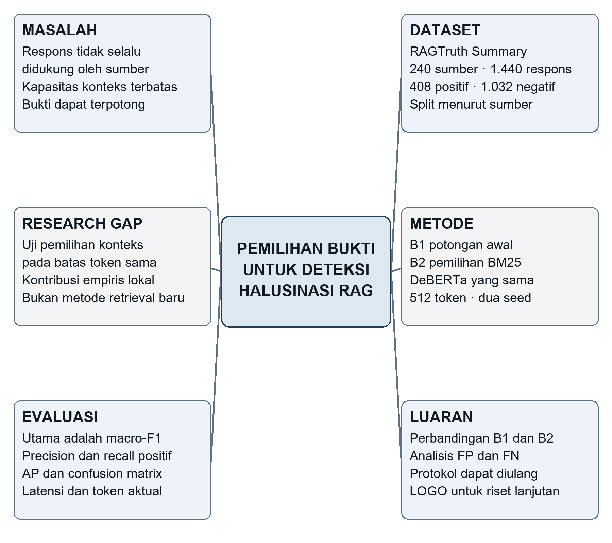
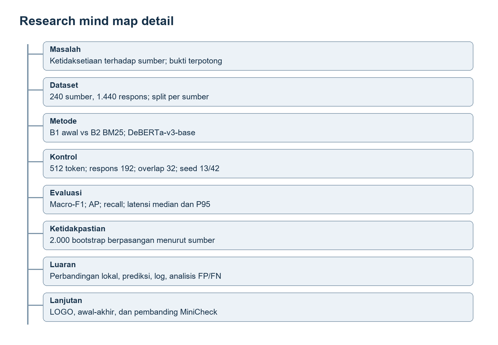
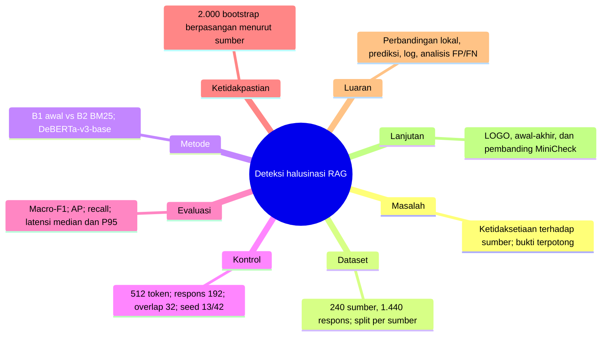

# 4 Research Mind Map

Peta berikut menghubungkan masalah penelitian dengan data, metode, gap, evaluasi, dan luaran. Semua cabang merujuk pada rancangan riset kecil dalam dokumen ini.

Gambar 1. Research mind map deteksi halusinasi berbasis pemilihan bukti.

## Alur kerja penelitian

Dataset kandidat → audit dan split final → pembentukan konteks B1/B2 → pelatihan detektor → pemilihan ambang pada validasi → evaluasi uji → analisis kesalahan.

Cabang evaluasi memberi dasar untuk menilai hipotesis. Cabang luaran mengarah pada simpulan tentang manfaat pemilihan konteks dalam batas eksperimen ini. LOGO baru ditambahkan pada tahap penelitian lanjutan.

## Peta rinci

